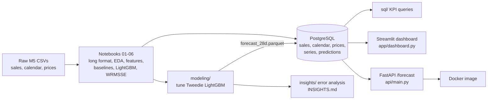

# M5 Forecasting: from raw sales to stock-planning decisions

**Business question:** Which stores, categories and day types (events, SNAP days) are hardest to forecast, and what does that mean for stock planning?

Built on the [M5 Forecasting - Accuracy](https://www.kaggle.com/competitions/m5-forecasting-accuracy) data (Walmart, {n_series} item-store series, daily unit sales, 2011-2016). The raw data is not included in this repo.

## What the analysis found

{findings}

Full write-up with the numbers and their sources: [INSIGHTS.md](INSIGHTS.md).

## Architecture



## Results

Validation setup: train on days up to d_1913, forecast the next 28 days (d_1914 to d_1941, {win_start} to {win_end}). Time-based split, lags at least 28 days old, no random splits. Lower WRMSSE is better.

{results_table}

- **Project metric** is the WRMSSE from the original Stage 6 notebook (average over 12 hierarchy levels).
- **Official-style** follows the competition's definition, which ignores the days before an item's first sale when scaling the error. It scores {gap_min} to {gap_max} lower in this project. Both are shown because the project numbers cannot be compared directly with published M5 scores.
- Tuned Tweedie improves the baseline Tweedie by {gain} (WRMSSE {base} to {tuned}). Of {n_trials} single changes tried, only `num_leaves=63` beat the baseline.

<details><summary>All tuning trials</summary>

{tuning_table}

`combo` merges every single change that beat the baseline. Only one did, so it repeats `leaves_63`.
</details>

## Dashboard

Streamlit app reading from PostgreSQL. A headline panel answers the business question first. Four tabs follow: a **Stock plan** page (pick a store and category, set a safety buffer, see how many of the 4 forecast weeks would have been covered, and the units short or left over), where the forecast is weak, forecast vs actual, and sales trends. The theme is set in `.streamlit/config.toml`.


## API

`GET /forecast?store_id=CA_1&item_id=FOODS_3_090` returns the 28 daily forecasts. Optional `model` parameter: `lgbm_tweedie_tuned` (default), `lgbm_tweedie`, `lgbm_regression`. Returns 404 for an unknown series and 503 if the database is unreachable. `GET /health` checks the database connection.

## Project structure

```
raw/                  M5 CSVs (not in repo)
data/processed/       parquet files from the notebooks (not in repo)
notebooks/ src/       Stages 0-6: data prep, EDA, baselines, features, CV, LightGBM
sql/                  schema, loaders, KPI queries
modeling/             WRMSSE metric, Tweedie tuning, final forecasts
insights/             error analysis and the generators for INSIGHTS.md / README.md
app/                  Streamlit dashboard (theme in .streamlit/)
api/                  FastAPI service and Dockerfile
outputs/              forecasts, per-series errors, tuning log, insight tables
docs/                 dashboard screenshots
```

## How to run

Prerequisites: Python 3.12 or newer, PostgreSQL running locally, and the M5 files in `raw/` plus the parquet files in `data/processed/` (created by the Stage 0 to 5 notebooks and scripts).

```bash
python -m venv myenv && source myenv/bin/activate
pip install -r requirements.txt

# database settings come from environment variables (see .env.example); no passwords in files
export PGHOST=localhost PGPORT=5432 PGDATABASE=m5 PGUSER=<your_user>   # add PGPASSWORD if needed
createdb m5

python sql/load_data.py                    # loads calendar, prices, last 730 days of sales, saved predictions
python sql/check_counts.py                 # row counts vs source files
python sql/load_tuned_predictions.py       # adds the tuned forecasts (needs outputs/forecast_28d.parquet)

# optional: reproduce the modelling results (about 15 minutes in total)
python modeling/tune_tweedie.py --run baseline
python modeling/tune_tweedie.py --run singles
python modeling/tune_tweedie.py --run combo
python modeling/finalize.py
python insights/analyse_errors.py && python insights/build_insights.py

streamlit run app/dashboard.py             # dashboard on http://localhost:8501
uvicorn api.main:app --port 8000           # API on http://localhost:8000/docs
```

SQL KPI queries: `psql -d m5 -f sql/01_sales_by_store_cat_month.sql` (also `02_...` and `03_...`).

Docker:

```bash
docker build -f api/Dockerfile -t m5-api .
docker run -p 8000:8000 -e PGHOST=host.docker.internal -e PGDATABASE=m5 -e PGUSER=<your_user> m5-api
```
Pass `PGPASSWORD` with `-e` at run time if your database needs one. It is never stored in the image.

## Limitations

- **One validation window.** All results are for a single 28-day window. The tuned model was chosen on that same window, so its small gain ({gain}) may be partly selection luck. A second fold would confirm it.
- **WRMSSE definition.** The metric lives in `modeling/wrmsse.py` and reproduces the Stage 6 scores for both models. It differs from the official M5 scorer as described above.
- **SQL history.** PostgreSQL holds the last 730 days of sales (about 22 million rows), not the full 59 million. Model training used the full history from the parquet files.
- **No cost data.** Buffer suggestions in INSIGHTS.md are based on forecast bias only. There was no stockout or holding-cost data.
- **SNAP and event findings are associations,** and the window has only {n_event_days} event days.
- **API and dashboard serve saved forecasts.** They do not run the model live, and they cover only the validation window.
