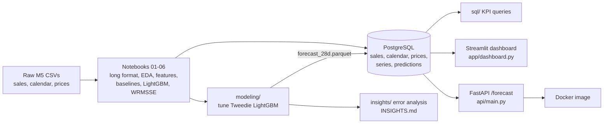

# M5 Forecasting: from raw sales to stock-planning decisions

I wanted to know where a retail demand forecast can be trusted and where it can't, and what that means for how much stock to order. This project takes the M5 Walmart data ({n_series} item-store series, daily unit sales from 2011 to 2016) through a SQL layer, a tuned LightGBM model, an error analysis, a dashboard and a small API.

**The question:** which stores, categories and day types (events, SNAP days) are hardest to forecast, and what does that mean for stock planning?

The raw data is not in this repo. You can get it from the [M5 Forecasting - Accuracy](https://www.kaggle.com/competitions/m5-forecasting-accuracy) competition page.

## What I found

{findings}

The full write-up, with sources for each number, is in [INSIGHTS.md](INSIGHTS.md).

## How it fits together



## Results

I trained on everything up to day 1913 and forecast the next 28 days ({win_start} to {win_end}). The split is by time, every lag feature is at least 28 days old, and nothing is split at random. The score is WRMSSE, the M5 competition metric, where lower is better.

{results_table}

Tuning the Tweedie model improved WRMSSE from {base} to {tuned}, a gain of {gain}. I tried {n_trials} single changes and only `num_leaves=63` helped.

<details><summary>All tuning trials</summary>

{tuning_table}

`combo` merges every single change that beat the baseline. Only one did, so it repeats `leaves_63`.
</details>

## Dashboard

The dashboard reads from PostgreSQL. It opens with the answer to the business question, then has four tabs. On the Stock plan tab you pick a store and category, set a safety buffer, and see how many of the 4 forecast weeks it would have covered and how many units would be short or left over.


## API

`GET /forecast?store_id=CA_1&item_id=FOODS_3_090` returns the 28 daily forecasts for that item. Add `model=` to pick `lgbm_tweedie_tuned` (the default), `lgbm_tweedie` or `lgbm_regression`. An unknown item returns 404, and if the database is down you get 503. `GET /health` checks the database connection.

## What's in the repo

```
notebooks/ src/       data prep, EDA, baselines, features, CV, LightGBM, WRMSSE
sql/                  schema, loaders, KPI queries
modeling/             WRMSSE metric, tuning, final forecasts
insights/             error analysis and the scripts that write INSIGHTS.md and this README
app/                  Streamlit dashboard (theme in .streamlit/)
api/                  FastAPI service and Dockerfile
outputs/              forecasts, per-series errors, tuning log, insight tables
docs/                 dashboard screenshots
```

The M5 files go in `raw/` and the parquet files the notebooks create go in `data/processed/`. Both are left out of the repo because of their size.

## Running it

You need Python 3.12 or newer and a local PostgreSQL.

```bash
python -m venv myenv && source myenv/bin/activate
pip install -r requirements.txt

# database settings come from environment variables (see .env.example)
export PGHOST=localhost PGPORT=5432 PGDATABASE=m5 PGUSER=<your_user>   # add PGPASSWORD if needed
createdb m5

python sql/load_data.py                    # calendar, prices, last 730 days of sales, saved predictions
python sql/check_counts.py                 # row counts vs source files
python sql/load_tuned_predictions.py       # adds the tuned forecasts

# optional: redo the modelling (about 15 minutes)
python modeling/tune_tweedie.py --run baseline
python modeling/tune_tweedie.py --run singles
python modeling/tune_tweedie.py --run combo
python modeling/finalize.py
python insights/analyse_errors.py && python insights/build_insights.py

streamlit run app/dashboard.py             # http://localhost:8501
uvicorn api.main:app --port 8000           # http://localhost:8000/docs
```

The three KPI queries run with `psql -d m5 -f sql/01_sales_by_store_cat_month.sql` (and `02_...`, `03_...`).

To run the API in Docker:

```bash
docker build -f api/Dockerfile -t m5-api .
docker run -p 8000:8000 -e PGHOST=host.docker.internal -e PGDATABASE=m5 -e PGUSER=<your_user> m5-api
```
If your database needs a password, pass `-e PGPASSWORD=...` when you run the container. It is never stored in the image.
